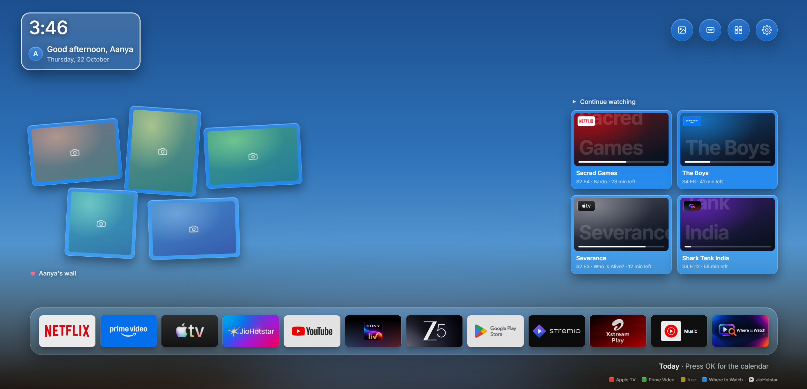
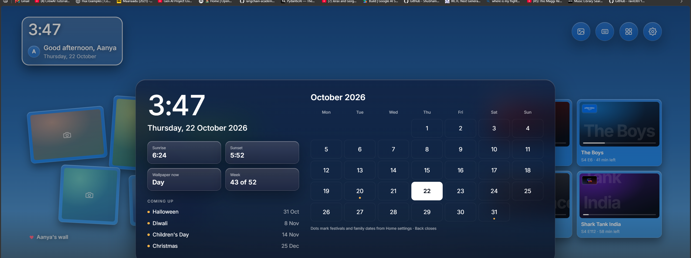
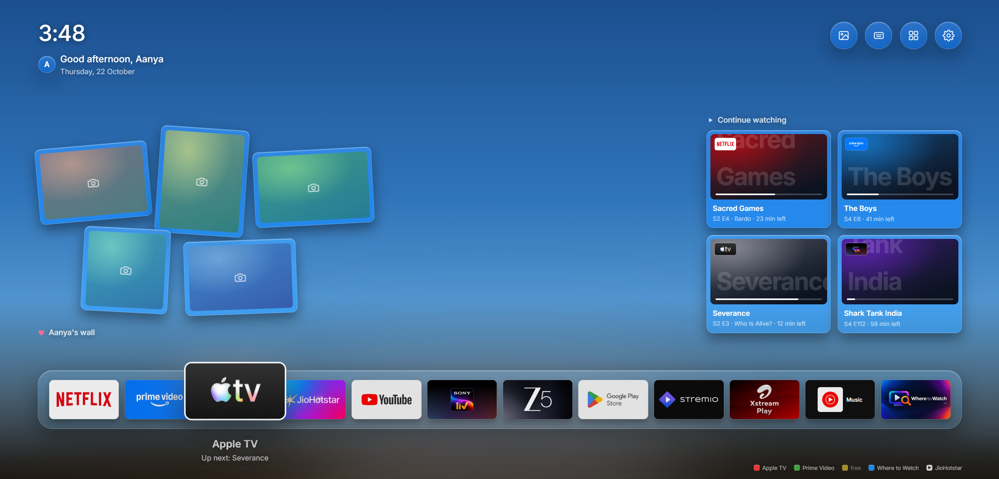

# tv-ui

A home screen for an Android TV, built for my daughter.

One row of apps with the real app artwork, a wall of her photos shuffled from a folder on the TV, "continue watching" across apps, a calendar page behind the clock, a wallpaper that follows the sun, and the remote's colour buttons mapped to the apps we actually use. No ads, no account, no cloud, no tracking.







*Design mock-ups; the photo frames are placeholders.*

## Apps in this repo

| Folder | What it is |
|---|---|
| `launcher/` | **TV Home** (`in.sid.launcher`). The home screen. Plain Java, no Gradle, no libraries, ~90 KB APK. Built for Android TV 10 on a 1.7 GB-RAM set, minSdk 29. |
| `tvkeyremap/` | **TV Key Remap** (`in.sid.tvkeyremap`). A small accessibility service that turns the remote's Google Play and colour buttons into app shortcuts. |

## Building

Both apps build with the Android SDK's own tools (aapt2, javac, d8, zipalign, apksigner), no Gradle:

```sh
cd launcher && bash build.sh      # -> launcher/launcher.apk
cd tvkeyremap && bash build.sh    # -> tvkeyremap/tvkeyremap.apk
```

`build.sh` expects Android Studio's JBR, build-tools 37 and platform 34 at the paths near the top of the script, and a signing keystore at `tvkeyremap/tvkeyremap.jks` whose password comes from `TV_KS_PASS` or a `keystore.properties` file (`pass=...`) in the repo root. The first `tvkeyremap/build.sh` run creates the keystore. Neither the keystore nor its password is committed.

## Installing on the TV

```sh
adb connect <tv-ip>:5555   # deploy.sh reads the address from TV_ADDR or tv.properties
adb install -r launcher/launcher.apk
adb shell pm grant in.sid.launcher android.permission.READ_EXTERNAL_STORAGE
adb shell pm grant in.sid.launcher android.permission.READ_TV_LISTINGS
adb shell mkdir -p /sdcard/Pictures/Aanya      # the photo wall reads this folder
adb shell cmd package set-home-activity --user 0 in.sid.launcher/.MainActivity
```

`launcher/deploy.sh` does the same for my TV. The launcher also appears as an ordinary app, so it can be tried before making it the home screen.

## How it is put together

- `HomeView` owns one focus index that walks the dock, the clock, the four top buttons, the photo wall and the continue-watching cards. All remote keys go through `MainActivity.dispatchKeyEvent`; Android's own view focus is kept out of it.
- `DockView` shows Leanback banners rasterised once into 320x180 bitmaps; the focused tile lifts out of the bar. The same view draws the All apps grid and the dock editor's "available" strip.
- `WallView` draws five glass-framed prints from `Pictures/Aanya`, reshuffled by day.
- `WatchNext` reads Android TV's Watch Next channel (`READ_TV_LISTINGS`) and spreads the cards across apps.
- `SkyView` renders the time-of-day wallpaper once into a bitmap. `Glass` is the translucent panel used everywhere; Android 10 has no live blur for apps, so it is fills and hairlines.
- `Special` holds festival and family dates for the calendar page and the Diwali sky.

Designed first as a working prototype on MagicPath, then written as a native app.
